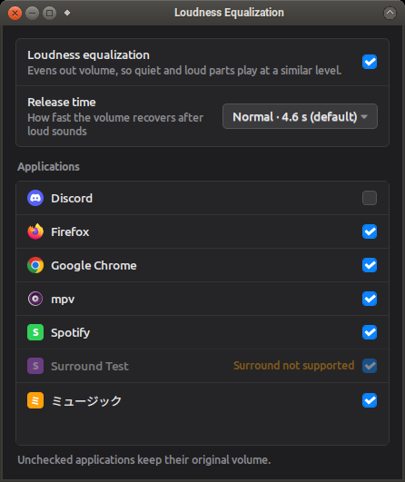

# pw-loudness-eq

Windows' Loudness Equalization, fully decompiled from `WMALFXGFXDSP.dll` and ported to PipeWire. It evens out the volume of each application, so quiet and loud parts play at a similar level.

<p align="center">
  
</p>

- **[`module/`](module)**: the PipeWire module and the DSP plugin. It processes every app's playback stream.
- **[`app/`](app)**: an optional window (GTK3) to turn it on or off, globally or per app, and set the release time.

## Install

Requires PipeWire ≥ 1.4, and GTK 3 for the window.

```sh
# Arch:   sudo pacman -S pipewire gtk3 pkgconf make gcc
# Debian: sudo apt install libpipewire-0.3-dev libspa-0.2-dev libgtk-3-dev pkg-config make gcc
make
sudo make install
systemctl --user restart pipewire pipewire-pulse wireplumber
```

To install only one part, use `make -C module` or `make -C app`. To uninstall, run `sudo make uninstall` and restart the same services.

## Usage

Open **Loudness Equalization** from your application menu, or run `pw-loudness-eq`.

The settings live in a PipeWire metadata object, so they can also be scripted:

```sh
pw-metadata -n loudness-eq 0 enabled false                               # turn off
pw-metadata -n loudness-eq 0 release 6                                   # release time, 2 (fast) to 7 (slow)
pw-metadata -n loudness-eq 0 disabled-apps '["Discord"]' Spa:String:JSON  # leave these apps alone
pw-metadata -n loudness-eq                                               # show settings
```

Changes apply immediately and are kept across restarts.

## Configuration

Defaults are in `/usr/share/pipewire/pipewire.conf.d/60-loudness-eq.conf`. To override them, copy it to `~/.config/pipewire/pipewire.conf.d/`.

| Arg | Default | |
|---|---|---|
| `enabled` | `true` | Start enabled |
| `release` | `4` | Windows "Release Time", 2 (fast) to 7 (slow). 4 is the Windows default |
| `stream.rules` | | Never process some apps: `[ { matches = [ { application.name = "Discord" } ] actions = { loudness-eq = false } } ]` |

Settings changed at runtime are saved in `~/.local/state/pw-loudness-eq/state.conf` and take precedence over this file.

## How it works

The module sets `audioconvert.filter-graph.90` on each app's playback stream, so the plugin runs inside that stream, before its volume and before mixing, like a Windows stream effect.

Not processed: JACK clients, streams with more than 8 channels, and Flatpak apps that use PipeWire directly (those going through PulseAudio are processed).

### The algorithm

A broadband automatic gain control. Despite the name, it doesn't equalize the spectrum.

1. Frame size N = 2^⌈log2(fs/100)⌉ (512 at 44.1/48 kHz), with 50% overlap.
2. Each channel is windowed with `w[n] = 16384·(1 − cos(2π(n+½)/N)) / (N/2)` and run through a real FFT to get the power spectrum.
3. Power is summed into 25 bands with edges at 100, 200, 300, 400, 510, 630, 770, 920, 1080, 1270, 1480, 1720, 2000, 2320, 2700, 3150, 3700, 4400, 5300, 6400, 7700, 9500, 12000, 15500 and 24000 Hz. Channels are summed together.
4. Loudness `L = 1.72 · Σ max(E_b − T_b, 1e-32)^0.25`, with T = `1000, 100, 31.6, 10, 3.16, 2, 1, 1, .316, .316, 1×11, 4, 10, 100, 1000`.
5. Target gain `= min((1300/L)^1.6, 10)`, so at most +20 dB.
6. When the target is lower than the current gain, the gain jumps to it instantly. Otherwise it moves toward it by `w = (N/128)·(44100/fs)·0.1^min(r,3)·0.316^(min(r,7)−min(r,3))` per block. At r = 4 that's a time constant of about 4.6 s.
7. The gain is crossfaded linearly across each half-frame. Latency is N samples.

There's no limiter, so pure tones can go above 0 dBFS (Windows does the same).

## Development

```sh
make check                                         # DSP and plugin tests
module/build/leq-wav [-r release] in.wav out.wav  # process a file offline
```
